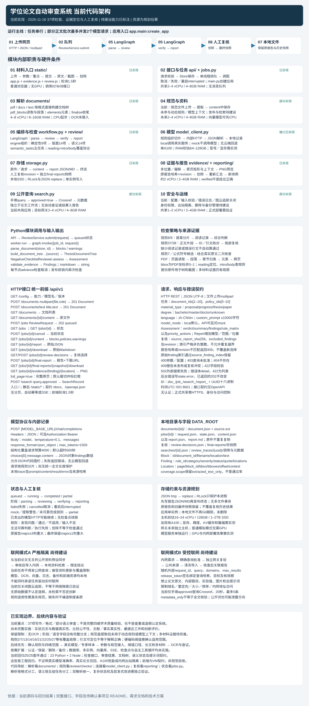
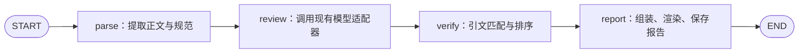
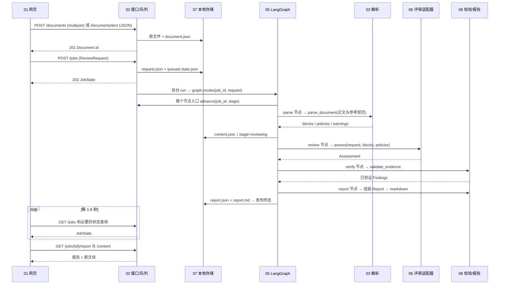

# Thesis Review Agent

本地论文评审 demo。Python / FastAPI 后端，LangGraph 串行工作流，原生 HTML、CSS、JavaScript 前端；不需要数据库、Redis、Node 构建工具或 GPU 即可运行模拟模式。外层 `组内项目` 目录保留，代码根目录是本目录。

方案确认材料：[需求文档](docs/需求文档.md) · [技术方案](docs/技术方案.md)。两份文档区分当前实现、后续建设与待确认事项，可用于上游评审。

## 完整架构图

[打开可缩放的完整 SVG](docs/architecture.svg)



图上半部保留此前的十个模块、模块内部流程、硬件预算和两种隔离模式；下半部补充通信契约、当前调用链、字段及实现映射。**上半部是目标架构，并不表示所有组件已部署；下半部和下文明确区分当前 demo 与规划。** 当前以代码及 `/openapi.json` 为已实现接口的依据。

阅读导航：[模块职责](#模块职责与实现映射) · [通信协议](#通信协议与公共约定) · [HTTP 接口](#当前-http-接口) · [内部调用](#当前模块内部调用) · [任务状态](#任务状态与时序) · [字段字典](#当前持久化字段字典) · [完整版本接口](#完整版本接口与数据设计规划)

## 启动

需要 Python 3.11+。在本目录执行：

```sh
python3 -m venv .venv
.venv/bin/python -m pip install -r requirements.txt
.venv/bin/python -m uvicorn app.main:create_app --factory --host 127.0.0.1 --port 8765
```

打开 http://127.0.0.1:8765 。接口文档在 `/docs`。仅供本机单用户使用，无登录鉴权；请保持绑定 127.0.0.1，只启动一个 worker、一个服务实例。

点击“填入测试材料”，选择模拟模式，再点击“开始评审”即可走完整链路。刷新页面后任务和报告仍保留。

## 目录与职责

```text
app/
  main.py       HTTP 路由、输入与异常响应
  schemas.py    业务请求与模型输出结构
  config.py     环境配置
  storage.py    JSON 和文件存储
  parsing.py    文本提取与来源定位
  review.py     模拟／本地模型适配、引文校验、报告渲染
  service.py    排队、取消、失败处理与任务生命周期
  workflow.py   LangGraph 四节点、状态传递与报告组装
  search.py     经用户批准的公开 Crossref 查证
  static/       页面、样式、交互
tests/          接口、持久化、取消与证据验证测试
```

排查方法：HTTP 输入问题看 `main.py/schemas.py`；解析失败看 `parsing.py`；模型错误看 `review.py`；阶段逻辑看 `workflow.py`，排队／取消看 `service.py`；文件问题看 `storage.py`。后台异常带 Job ID 输出到控制台，状态文件保存错误描述，不做静默模型切换或多轮自动修复。

## 本地数据

默认存入代码根目录 `data/`，可用 `DATA_ROOT` 指定绝对目录。

```text
data/
  documents/<doc_id>/
    document.json   文件名、角色、后缀、大小、SHA-256、创建时间
    source.ext      原始文件（文本输入保存为 source.txt）
  jobs/<job_id>/
    request.json    材料 ID、规范 ID、类型、学位、语言、提示词、模式
    state.json      ID、标题、状态、阶段、时间、错误
    content.json    正文块、规范块、提取警告
    report.json     判断、问题、引用、建议、限制、覆盖统计、模型标识
    report.md       可下载报告
  searches/<search_id>.json   批准的查询、时间、公开元数据结果
```

每个正文块包含 `id/document_id/filename/location/text`；报告问题包含维度、严重程度、待核实状态、块 ID、确切引文、问题描述、建议和位置。JSON 通过临时文件替换更新；报告写完后才发布任务完成状态。存储不是数据库事务系统，不支持多进程并发写入。运行中断后任务标记为 interrupted，可重新提交；不自动恢复半个模型调用。

数据目录已加入 `.gitignore`。无需为每次模型调用生成单独快照或复制原件，查看单个任务目录即可定位问题。

## 模型接入

默认模拟模式只识别 TODO、待补充等标记，不进行学术质量判断，所有报告标注“模拟”。

要接入内网 OpenAI-compatible Chat Completions 服务，在启动前设置：

```sh
export MODEL_BASE_URL=http://127.0.0.1:8001/v1
export MODEL_NAME=your-internal-model
# 如服务需要认证，再设置 MODEL_API_KEY。
```

重启后页面可选内网模型。服务需支持 `response_format: json_object`，输出须匹配 `Assessment` 结构。配置地址只能由管理员通过环境设置；本 demo 不自动识别地址是否处于内网，必须确保配置指向可信本地／内网服务。失败直接报告错误，不回退云模型。输入上限暂为 60,000 字符，超限明确拒绝，不静默截断。

## 最小 LangGraph 工作流

LangGraph 负责阶段顺序和内存状态传递；它本身不是模型服务，也不需要 GPU 或独立服务器。本次使用 `langgraph==1.2.20`，通过 [StateGraph API](https://docs.langchain.com/oss/python/langgraph/graph-api) 定义固定流程：



`ReviewService` 初始化时调用 `build_workflow(store, settings, self.advance)`，编译一次；队列里的每个任务调用 `graph.invoke({"job_id": identifier, "request": request})`。每次调用有独立的 `ReviewState`。节点只返回新增或更新字段，LangGraph 合并后传给下一节点，不重复复制正文或保存额外中间文件。

| 节点 | 读取的状态 | 返回的状态／文件副作用 |
| --- | --- | --- |
| parse | request.document_ids / policy_ids、job_id | blocks、policies、warnings；保存 content.json，无正文时抛错 |
| review | request、blocks、policies | assessment: Assessment；复用 MockReviewer 或 LocalReviewer |
| verify | assessment、blocks | findings: Finding[]；引文不匹配则抛错 |
| report | 上述状态 | 组装 Report，调用 markdown；保存 report.json / report.md 后发布终态；返回空更新 |

`ReviewState` 是 `TypedDict`：job_id、request 在调用时提供，其余字段由前序节点产生；request、assessment、findings 在内存中保留 Pydantic 对象。模块内使用 Python 对象调用，文件与 HTTP 仍使用既有 JSON 结构。内存里的图状态与磁盘 `state.json` 不同：后者只保存面向页面的任务状态，不是 LangGraph 检查点。

每个节点通过 `advance(job_id, stage)` 更新状态并检查取消。取消抛出 `ReviewCancelled`，由 service 正常结束；其他异常由 service 记录日志并标记 failed。报告节点在锁内再次检查取消，写完两种报告才发布完成状态。已经发出的模型请求不会被强制终止。

未配置 checkpointer、自动重试或动态搜索分支；不启用 LangGraph Server、数据库或云端追踪。`run()` 使用 `tracing_context(enabled=False)` 关闭该次执行的 LangSmith 追踪，包括环境变量已开启追踪的情况；安装依赖不表示使用云服务。重启后的未完成任务仍标记 interrupted，需重新提交。独立的手动 Crossref 查询继续通过原 `/search` 接口执行。

## 当前能力与边界

- 上传 PDF、DOCX、TXT、PNG、JPG，支持粘贴文本、额外提示词、参考规范、多材料和中英文输出。
- 真实提取 PDF 文本、DOCX 正文与表格、TXT 行；点击问题可展开来源文本；原文件可通过接口下载。
- 图片和扫描件尚无 OCR。图片只保存；无文本时任务失败，有部分文本时列出未审范围。PDF 图表视觉结构、DOCX 脚注与公式也未完整提取。
- 本地模型接受四维评审约束及材料类型／学位条件；引文必须匹配实际正文，否则整个任务明确失败。
- 查询只在用户手动输入公开词条并勾选批准后发往 Crossref；不传论文、不自动写入报告，也不宣称完成全文文献核验。联网异常返回 502。
- 规范是参考材料，尚未实现版本发布、适用范围核定和制度合规自动判断。
- 使用 LangGraph 四节点串行工作流；用 1.5 秒轮询展示状态，用五个任务文件保存任务，不额外保存图状态快照。暂不提供重试 Run、向量索引、GPU 部署、自动搜索或复杂审批网关；后续沿现有模块边界扩展。
- 取消会阻止结果发布；已发出的模型 HTTP 请求可能持续到返回或超时。控制台日志与任务状态可追踪失败。

## 验证

```sh
.venv/bin/python -m unittest discover -s tests -v
```

测试使用临时目录；默认不调用任何外部模型或搜索服务。覆盖完整图执行、阶段顺序、规范传递、任务间状态隔离、引文失败、模型返回前取消、五文件落盘、重启中断与禁用云端追踪。

## 模块职责与实现映射

编号对应 SVG。CPU／RAM 是低并发部署预算，资源可共享，不是每个模块独占一台服务器，也不是实测结论。

| 模块 | 职责、内部流程与输出 | 当前实现位置／边界 | 硬件起点 |
| --- | --- | --- | --- |
| 01 材料入口 | 上传或粘贴 → 设置类型／学位／语言／重点 → 提交；展示任务、报告、原文与下载 | `app/static/`；原生网页，非 React | 普通浏览器；静态服务约 1 vCPU／1GB，无 GPU |
| 02 业务与调度 | 校验请求 → 保存材料／任务 → 排队 → 取消或完成；输出任务状态 | `main.py`、`schemas.py`、`service.py`；单进程、单后台 worker，无认证／Celery／Redis | 2–4 vCPU／4–8GB，无 GPU |
| 03 文档解析 | 格式分流 → 正文／表格文本提取 → 绑定位置 → 输出块和警告 | `parsing.py`；pypdf、python-docx、UTF-8 文本。OCR、版面和图片理解待接入 | 4–8 vCPU／8–16GB；GPU 非必需 |
| 04 规范与检索 | 目标：规范确认发布 → 按适用范围筛选 → 混合检索 → 返回条款及出处 | 当前由 03 提取所选规范全文，05 直接使用；无版本发布、向量库或自动近邻检索 | 2–4 vCPU／4–8GB；本地向量模型可先用 CPU |
| 05 评审编排 | 确定尺度 → 检查材料 → 生成四维候选问题 → 交给 08 验证；维护执行状态 | `workflow.py` 的 LangGraph StateGraph；`ReviewService.run()` 调用编译后的图。当前单次模型调用，不具备动态工具循环或长文分章调度 | 2–4 vCPU／4–8GB；复用 06 |
| 06 模型服务 | 接收上下文 → 推理 → 返回结构化 Assessment；目标支持受控工具调用 | `MockReviewer`／`LocalReviewer`；模拟或 HTTP Chat Completions。当前无 GPU 服务，未实现 tool_calls 执行循环 | 模拟无 GPU；目标 A100 40GB 验证 27B Int4，80GB 验证 BF16；主机 RAM 64–128GB |
| 07 数据存储 | 接收元数据与文件 → JSON 原子替换／原文件写入 → 按 ID 读取 | `storage.py`；本地目录和进程锁，无 PostgreSQL／pgvector | 2–4 vCPU／8–16GB；SSD 随保留期增长 |
| 08 校验与报告 | 引文匹配 → 问题排序 → JSON／Markdown → 发布报告 | `validate_evidence()`、`markdown()`、`workflow.py`；当前仅校验引用存在，不代表验证了推论正确性，数值和反证复核待实现 | 2 vCPU／2–4GB；语义复核未来复用 06 |
| 09 联网网关 | 目标：内网批准精确查询 → 网关复验 → 获取公开证据 → 记录来源 | 当前 `/search` + `search.py` 是手动批准的独立 Crossref 查询，无 DMZ 服务、签名批准凭据或自动入报告 | 目标独立 2–4 vCPU／4–8GB／20–50GB SSD，无 GPU |
| 10 安全与运维 | 目标：认证 → 权限隔离 → 出网策略 → 审计／删除／告警 | 当前仅本机绑定、输入校验、控制台日志与错误状态；无多用户、审计日志服务或网络级隔离 | 共享 1–2 vCPU／2–4GB |

正式内网部署可先规划一台 16–24 vCPU、128GB RAM、1–2TB SSD 加现有 A100 的主机，以及独立联网主机。当前模拟 demo 无需上述整套资源。单卡先串行评审；显存预算须包含模型权重、缓存、图像与运行时开销。

四维检查的完整目标如下；模拟模式并未实现这些学术判断。

| 维度 | 检查范围 | 判断边界 |
| --- | --- | --- |
| 结果可信度 | 数据来源、划分与泄漏、比较公平性、指标、样本数、均值、提升幅度、正文与图表矛盾 | 无原始数据和日志不认定造假；提出具体待核查材料 |
| 内容可靠性 | 提示词残留、占位内容、术语与解释、文献／公式／事实可靠性 | 不凭文风认定 AI 代写，不给 AI 比例 |
| 规范与逻辑 | 引用与成果归属、符号／单位、问题—方法—实验—结论链条、章节主线 | 重要逻辑问题优先；排版问题简列 |
| 创新与价值 | 最接近工作、问题价值、新增贡献、组合创新证据与独立研究深度 | 未检索不断言无创新，不把性能提升等同创新 |

尺度：开题看问题与路线可行性；中期看实际进展及剩余工作；学位论文看完整性、统一主线和本人贡献；小论文看核心贡献与投稿质量。本科关注规范与基本能力，硕士关注有价值的研究贡献，博士关注实质创新与深度，专业学位兼顾实践创新；层次不明限定判断条件。目标语言规则是开题／中期／学位材料用中文、英文小论文默认英文，用户设置优先；当前 demo 的语言由表单明确选择，尚未自动识别英文小论文，也没有单独的专业学位字段。

## 通信协议与公共约定

| 通道 | 当前 demo | 完整版本规划 |
| --- | --- | --- |
| 页面 ↔ 02 | 同源 HTTP REST；JSON UTF-8；上传 multipart/form-data；下载原文件或 Markdown | 内网 HTTPS、认证、权限；接口显式版本化 |
| 进度通知 | 每 1.5 秒 GET 任务列表／详情；无 SSE 路由 | SSE `text/event-stream`，事件序号递增，Last-Event-ID 续传、客户端去重 |
| 后端模块 | Python 类型化函数／对象调用；同步函数由单后台线程执行 | 保持业务 DTO；必要时拆内部 HTTP 服务 |
| 05 ↔ 06 | `POST {MODEL_BASE_URL}/chat/completions`，JSON 请求／响应；180 秒超时；可选 Bearer 密钥 | 接 vLLM；按模型验证 JSON Schema、工具调用及多模态能力 |
| 09 ↔ 公网 | HTTPS GET Crossref `/works`；20 秒超时；仅手工批准的 query | 独立网关、域名与重定向控制、精确查询授权；SearXNG 和官方全文来源 |
| 模块 ↔ 07 | Store 对象访问文件；JSON 写临时文件后 replace；RLock 限制本进程写入 | Repository 替换为数据库／对象存储，事务与并发控制 |

当前前缀 `/api/v1`；ID 为 `doc_`／`job_`／`search_` 加 UUID 十六进制；时间为带 UTC 偏移的 ISO 8601；JSON 使用 snake_case。正文块 ID 是 `<document_id>:b<N>`，位置是字符串。`schema_version` 当前只写入报告；无全局 request_id、revision、Idempotency-Key、Run 或 Artifact 资源。不要把目标契约中的这些字段当成当前已支持参数。

业务异常返回 `{"detail":"具体原因"}`：400 输入／配置问题，403 搜索未批准，404 资源不存在，409 报告未发布，422 Pydantic 字段校验失败（detail 为列表），502 外部搜索失败。后台异常写入 `state.error` 并在控制台输出 Job ID 和堆栈；浏览器轮询到 failed 后显示错误。

## 当前 HTTP 接口

下表路径均以 `/api/v1` 开头；`{id}` 对应代码中的 `{identifier}`。

| 方法／路径 | 输入 | 成功响应 | 调用关系 |
| --- | --- | --- | --- |
| GET `/config` | 无 | 200：local_model_available、model_name、ocr_available、storage、version | 01 获取服务能力，不返回密钥 |
| POST `/documents` | multipart：file、role=primary/policy；单文件非空且 ≤30MiB | 201：Document | 01 → 02 → 07.save_document |
| POST `/documents/text` | JSON：title（默认粘贴材料，≤200字符）、text（1–500000字符，非空白） | 201：Document；保存为 TXT | 01 → 02 → 07 |
| GET `/documents` | 无 | 200：Document[]，创建时间倒序 | 01 → 07；前端筛选已保存规范 |
| GET `/documents/{id}/content` | 文档 ID | 200：原始文件下载 | 01 → 07 |
| POST `/jobs` | ReviewRequest，字段见下 | 202：JobState，初始 queued；后续异步执行 | 01 → 02.submit → 后台 run → 05.graph.invoke |
| GET `/jobs` | 无 | 200：JobState[]，创建时间倒序；无分页 | 01 → 07 |
| GET `/jobs/{id}` | 任务 ID | 200：JobState | 01 → 07 |
| POST `/jobs/{id}/cancel` | 无需业务请求体 | 200：状态；终态不改变 | 01 → 02.cancel → 07 |
| GET `/jobs/{id}/content` | 任务 ID | 200：blocks、policies、warnings；解析前 404 | 01 → 07；展开引用所在文本 |
| GET `/jobs/{id}/report` | 任务 ID | 200：Report；仅 completed/partial 可读，否则 409 | 01 → 07 |
| GET `/jobs/{id}/download` | 任务 ID | 200：review-report.md；同报告发布条件 | 01 → 07 |
| POST `/search` | JSON：query（2–300字符）、approved=true | 200：SearchRecord；approved=false 返回403 | 01 → 09 → Crossref → 07；不经论文评审流程 |

静态入口 `/`、资源 `/static/*`；交互文档 `/docs`，机器可读契约 `/openapi.json`。同一创建请求重复提交会创建新资源；当前无幂等键、自动重试和自动去重。

创建任务示例（ID 为示意，需替换成上传接口返回值）：

```json
{
  "document_ids": ["doc_<uuid>"],
  "policy_ids": [],
  "material_type": "thesis",
  "degree": "master",
  "language": "zh-CN",
  "custom_prompt": "重点核查实验条件与图表一致性。",
  "model_mode": "mock"
}
```

| ReviewRequest 字段 | 约束／默认 |
| --- | --- |
| document_ids | 1–10 个已保存文档 ID，必填 |
| policy_ids | 0–10 个参考材料 ID，默认 [] |
| material_type | proposal / progress / thesis / paper，默认 thesis |
| degree | bachelor / master / doctor / unknown，默认 master |
| language | zh-CN / en，默认 zh-CN |
| custom_prompt | ≤10000 字符，默认空串；调整重点，不覆盖证据要求 |
| model_mode | mock / local，默认 mock；local 由环境配置服务地址 |

## 当前模块内部调用

| 调用者 → 被调用者 | 函数／方法 | 输入 → 输出与副作用 |
| --- | --- | --- |
| 02 → 07 | `Store.save_document(filename, content, role)` | bytes → Document；保存原件及 document.json |
| 01 → 02 | `ReviewService.submit(request)` | ReviewRequest → queued JobState；保存 request/state，提交单线程队列 |
| 02 → 05 | `graph.invoke({"job_id": id, "request": request})` | `run()` 调用；逐节点合并 ReviewState，产物写本地文件；异常交回 service |
| 05 → 02 | `advance(job_id, stage)` | 每个节点入口更新阶段并检查取消；false 时终止图，保留 cancelled |
| 05.parse → 03 | `parse_document(store, document_id)` | 文档 ID → `(blocks, warnings)`；同样解析所选规范，写入 content.json 由 05 负责 |
| 05.review → 06 | `MockReviewer.assess(request, blocks, policies)` | 结构化上下文 → Assessment；仅标记检测，不出网 |
| 05.review → 06 | `LocalReviewer.assess(request, blocks, policies)` | 同样输入 → 模型 HTTP → Pydantic Assessment；失败抛异常，无云端回退 |
| 05.verify → 08 | `validate_evidence(assessment, blocks)` | 验证 block_id 存在且 quote 是原文子串；失败抛异常；成功返回按 major 优先排序的问题 |
| 05.report → 08 | `markdown(report)` | Report → Markdown 字符串；固定三部分，附范围与限制 |
| 05 → 07 | `write/read/update_job` | 元数据与产物读写；报告写完后发布完成状态 |
| 01／02 → 09 | `search_public(query)` | 明确批准的字符串 → 最多 5 条 Crossref 元数据；不接收论文或模型上下文 |
| 全部后台阶段 → 10 | `logging.exception` | Job ID + 堆栈；state.error 保存错误；无独立审计文件 |

模型请求详细契约：Content-Type 为 application/json；可选 `Authorization: Bearer …`；body 为 `model`、`temperature=0.1`、`messages=[system,user]`、`response_format={"type":"json_object"}`。user 内容是 JSON 字符串，包含 request、blocks、policies、output_schema；序列化后超过 60000 字符直接拒绝，不截断。读取响应 `choices[0].message.content`，其内容必须是 Assessment JSON，不支持 Markdown 围栏或 tool_calls 响应。模型地址仅由管理员配置，不属于前端请求参数。

Crossref 请求为 `GET https://api.crossref.org/works?query.bibliographic=<URL编码查询>&rows=5`。提取 `message.items` 的题名、DOI、URL，统一标记 `scope=metadata_only`，保存请求与结果。当前只用 approved 布尔值表达本机用户批准，不能替代正式系统的认证授权、出网审查和签名凭据。

## 任务状态与时序



状态与阶段相互独立：

| 类型 | 值与含义 |
| --- | --- |
| status | queued 排队；running 执行；completed 流程结束；partial 有限范围结果；failed 失败；cancelled 取消；interrupted 重启中断 |
| stage | queued → parsing → reviewing → verifying → reporting；失败／取消时保留最后阶段 |
| verdict | 基本满足／需修改／存在重大问题／信息不足；这是论文判断，不是任务运行状态 |

当前任意解析警告或模拟模式都会得到 partial；无警告的真实模型执行可能得到 completed，但仍不表示完整合规或论文通过。取消立即将状态标记为 cancelled，之后阶段检查与发布检查阻止结果发布，已发出的 HTTP 请求可能仍在运行。服务启动把遗留 queued/running 改为 interrupted；重新提交生成新 Job，没有 resume 或 Run 检查点恢复。

## 当前持久化字段字典

以下字段与代码一致。所有记录留在 DATA_ROOT；身份、版本快照和事件投影等完整版本字段尚未实现。

| 文件／对象 | 字段与内容 |
| --- | --- |
| document.json / Document | id: string；filename: 原始显示文件名；suffix: 文件后缀；role: primary/policy；size_bytes: int；sha256: 原文件 SHA-256；created_at: UTC 时间 |
| request.json | 完整 ReviewRequest；原件不复制到任务目录，通过 document_ids/policy_ids 引用 |
| state.json / JobState | id: Job ID；title: 首份材料文件名；created_at/updated_at；status；stage；error: string/null；mode: mock/local |
| content.json | blocks: 正文 Block[]；policies: 参考规范 Block[]；warnings: string[] |
| Block | id: `<doc_id>:b<N>`；document_id；filename；location: PDF物理页/段落/表格行/文本行；text: 原文 |
| Assessment | verdict；summary: string；findings: Finding[]；priority_actions: string[] |
| Finding | dimension: 四维之一；severity: major/minor；status: supported/pending_verification；block_id；quote: 非空原文；issue；suggestion |
| report.json / Report | Assessment 的字段 + schema_version=1.0、job_id、mode、model_name、generated_at、limitations: string[]、coverage；每个问题补充 filename/location |
| coverage | block_count；document_count；scope 固定为 extracted_text_only。仅统计提取范围，不是完整四维检查率 |
| report.md | 由报告渲染的文本；包括总体判断、关键问题表、优先事项和限制。不要单独编辑后当作结构化报告已更新 |
| searches/<id>.json / SearchRecord | id；query；approved=true；created_at；results: 题名title、doi、url、scope=metadata_only 的数组 |

定位边界：PDF 仅使用从 1 开始的物理页序；DOCX 段落和表格分别编号，不生成页码；TXT 使用从 1 开始的行号。当前没有 bbox、字符偏移、parse_id 或 evidence_id，证据通过 block_id + quote 回到 content.json。无 OCR、无文本的页会列出警告；图片只保存原件。

写入顺序为原文件／解析结果 → report.json → report.md → 完成状态。JSON 单文件用临时文件替换，不承诺多文件事务；原始文件与 Markdown 使用普通写入。读取依据 state.json；异常不自动补齐缺失产物。RLock 只保护本进程，不是跨进程写锁，所以只运行一个实例。不得把数据目录放在多个服务同时写入的共享盘上。

## 完整版本接口与数据设计（规划）

本节保留此前完整设计，便于后续协作；这些接口和字段不能直接用于当前 demo。扩展时先版本化契约，再逐项替换适配器，不额外复制整个业务流程。

### 业务接口与协议

| 目标接口 | 输入 → 输出 | 当前对应情况 |
| --- | --- | --- |
| create_document / create_review_job | 文件／冻结请求 → document_id / job_id / run_id | 已有上传与创建任务；无 run_id |
| parse_document / read_document_blocks | 文档版本／块范围 → parse_id、清单／带定位原文 | 已有解析；暂无独立解析版本与按块读取接口 |
| retrieve_rules / retrieve_literature | 适用条件、查询、资料范围 → 条款／文献证据 | 所选规范全文与独立手动搜索；无检索服务 |
| recalculate_values | 输入数值、单位、运算、证据 → 过程、结果、异常 | 待实现 |
| generate_structured | 上下文、输出 Schema、受控工具定义、预算 → 结果或工具请求 | 当前仅返回 Assessment JSON，无动态工具调用 |
| propose_search | 内网查证目的、候选查询 → 允许／拒绝／待审核 | 当前只允许用户手工公开查询 |
| execute_released_search | 批准的精确查询 + 有效授权 → 公开证据 | 当前布尔批准；独立网关待实现 |
| validate_findings / publish_report | 候选问题、证据、覆盖 → 已验证问题、驳回原因、报告引用 | 已有引文匹配／报告；语义、数值与反证复核待实现 |
| record_audit_event | 操作者、对象、操作、结果 → 审计 ID | 当前只有运行日志 |

目标新增 HTTP 资源：GET `/documents/{id}` 与 `/documents/{id}/parses/{parse_id}`；GET `/jobs/{id}/events`（SSE）、`/findings`；POST `/jobs/{id}/retry`、`/resume`；GET `/evidence/{id}`、`/artifacts/{id}`、`/artifacts/{id}/content`；POST `/policy-versions`、`/policy-versions/{id}/publish`；GET `/policy-versions`、`/jobs/{id}/search-requests`；POST `/search-requests/{id}/decision`。任务列表增加分页与筛选。

完整契约拟采用 OpenAPI 3.1 与 JSON Schema 2020-12；资源增加 schema_version、owner_id、created_at、可变资源 revision；请求增加 request_id。创建／重试／审批使用 Idempotency-Key，同键不同内容返回409；统一错误体为 `{"request_id":"…","error":{"code":"…","message":"…","retryable":false,"details":{}}}`。现有 demo 使用 detail 响应，升级时需同步前端。

### Document、Job、Run 与文件版本

Document 代表不可变上传版本，修改稿生成新 ID；Job 冻结材料、提示词、规范和工作流配置；Run 代表一次执行，重试生成新 Run、保留历史。修改材料或提示词创建新 Job。公开来源、证据、问题和报告使用独立 ID；不把模型生成的页码直接作为真实位置。

| 目标文件／对象 | 保存字段 |
| --- | --- |
| Document | document_id、original_filename、media_type、size_bytes、sha256、source_artifact_id、input_kind、language、parse_ids |
| ParseManifest | parse_id、document_id、来源哈希、解析器名称／版本／配置哈希、状态、起止时间、页数／块数、警告、产物引用 |
| Section / Block / Table / Figure | 层级与阅读顺序；block_id、parse_id、section_id、原文、抽取方式、可用置信度；表格单元格／合并信息／数值单位；图片和图注及裁图引用 |
| Locator | PDF page_index/page_label/bbox；DOCX章节／段落／表格位置；图片 artifact_id/bbox；文本 paragraph_index/text_range；绑定解析版本 |
| 冻结请求 | 材料角色、单位／年份／学位类型、材料阶段、语言、规范版本、用户与默认提示词版本／哈希、隐私模式、模型／解析／搜索配置快照、工作流版本、请求哈希、创建者 |
| Run / Plan | run_id、job_id、父Run、执行原因、组件版本与真实／模拟清单；应审章节与维度、必要步骤、规范、工具预算、阶段依赖 |
| 阶段结果 / Checkpoint | 输入与配置哈希、状态、产物引用、警告／错误／耗时；已完成和待处理单元、恢复引用、兼容性指纹 |
| 状态快照 / Head | 当前Run、状态与阶段、进度、待审批查询、取消标志、已提交产物、错误、revision、新事件；Head指向已提交版本路径与哈希 |
| Evidence | evidence_id、source_type（document/policy/web/calculation）、source_ref、parse_id/block_ids、locator、quote、来源内容哈希、抽取方式、verified/unverified/mismatch、origin、创建时间 |
| CalculationEvidence | operation、inputs、units、formula、result、input_evidence_ids；由程序计算，不伪造统计检验 |
| Finding | finding_id、dimension、severity、verification_status、title、description、impact、evidence_ids、counter_evidence_ids、policy_clause_ids、recommendation、required_materials、review_scope、validation_status、origin |
| Coverage / Validation | 章节／图表 × 必要检查项的 checked/not_applicable/unverifiable/not_checked 及原因；引文、位置、数值、证据支持、去重与驳回结果 |
| Report | report_id/job_id/run_id、overall_verdict、summary、排序finding_ids、priority_actions、scope_statement、compliance_statement、limitations、language、execution_mode、source_versions、generated_at、rendered_artifact_ids |
| Policy / Clause | 发布单位、名称、版本、生效时间、适用单位／年份／学位／阶段、来源文件及哈希、确认人与发布时间；条款原文、位置、明确要求／定性指导、确认状态 |
| PublicSource | source_id、题名、作者、DOI等标识、URL、发表／获取时间、版本、内容哈希、content_scope（metadata_only/snippet_only/abstract/full_text） |
| 搜索草稿／决定／执行 | 目的、候选查询、关联问题、隐私模式、策略版本；精确批准查询及哈希、目标范围、审核者、理由、期限；实际查询哈希、网关请求ID、提供方、状态、来源与错误 |
| Artifact / ToolCall / Audit | 产物归属、相对storage_key、类型、大小、哈希、origin；工具名与版本、输入输出引用、状态、次数、耗时／错误；操作者、对象、操作、决定、时间、request_id |

目标 bbox 为旋转后的页面／图像左上角原点、0–1 归一化坐标；text_range 为块内 Unicode 码点偏移，左闭右开，前端需与 JavaScript UTF-16 索引转换。DOCX 转 PDF 的页码只属于该派生快照。severity 与 verification_status 分开；模拟证据和真实证据必须记录 origin，正式报告不能隐藏模拟成分。

目标目录在现有 documents/jobs 基础上增加 `documents/<id>/parses/<parse_id>/`、`policies/<version_id>/`、`reference_sources/<source_id>/`、`jobs/<id>/runs/<run_id>/`、`snapshots/`、`head.json`、`events.jsonl`、`artifacts/`、`audit/` 与可重建 `indexes/`。这不是当前 demo 的落盘结构；在确有重试、版本及多用户需求后引入。

目标提交协议：先写并校验不可变产物，再写不可变状态快照，最后原子替换 Head 作为提交点，之后更新事件投影和索引；未提交孤立文件可清理，索引可重建。SSE事件包含 job_id/run_id/event_seq/type/created_at/data，data 只放阶段、状态版本和产物引用，不放全文。服务重启标记 interrupted；恢复只有在材料、提示词、规范、模型及工作流兼容时才能复用检查点。跨文件原子性、幂等登记和进程锁需专门实现，不能假定文件系统天然提供数据库事务。

### 联网与隐私边界

| 模式 | 出网路径 | 能力与限制 |
| --- | --- | --- |
| 严格隔离（目标） | 与具体论文无关的预设公开资料同步 → 单向导入内网资料库 | 当前任务不能生成外部查询；创新判断受资料更新范围限制 |
| 受控联网（目标） | 05提出查证 → 04内网批准精确查询 → 09复验 → 公网 → 清洗证据 → 04/07 | 禁止原文、内部题目／项目、实验数值、图片和完整提示词；公开词组合仍可能透露方向 |
| 当前 demo | 用户手填公开查询 → approved=true → 同一后端调用 Crossref | 与任务独立；无自动论文出网，但不是正式隔离网关。模型地址同样需管理员确保指向内网 |

目标网关只接收随机外部 request_id、query、allowed_domains、max_results 和签名短期 release_token。签名绑定查询哈希、目标和有效期；不发送内部 Job ID、用户身份或未批准草稿。网关限制域名、重定向、参数、大小、频率和内网地址访问。搜索摘要不等于全文核验，查不到不等于文献虚构，自建 SearXNG 也不意味着查询不出网。

正式部署还需本地 OCR／向量／日志／备份／前端资源，离线导入镜像与权重，关闭外部遥测、自动下载和云端追踪；论文与网页中的指令作为数据，不授予任意 shell、路径或网络权限。管理员发布规范并确认适用范围；缺少教育部、国科大、信工所或提供的文件时明确限定合规结论，不编造条款。

## 设计依据

架构是本项目设计；以下链接为所参考组件的官方资料；LangGraph 与 Crossref 已接入，其他组件是否实现以本文模块表为准：[LangGraph](https://docs.langchain.com/oss/python/langgraph/overview)、[vLLM](https://docs.vllm.ai/en/latest/features/quantization/)、[Qwen3.5-27B](https://huggingface.co/Qwen/Qwen3.5-27B)、[Docling](https://docling-project.github.io/docling/)、[Crossref](https://www.crossref.org/documentation/retrieve-metadata/rest-api/)、[SearXNG](https://docs.searxng.org/user/about.html)、[OpenAPI](https://spec.openapis.org/oas/v3.1.0)、[JSON Schema](https://json-schema.org/draft/2020-12)、[SSE](https://html.spec.whatwg.org/multipage/server-sent-events.html)。
