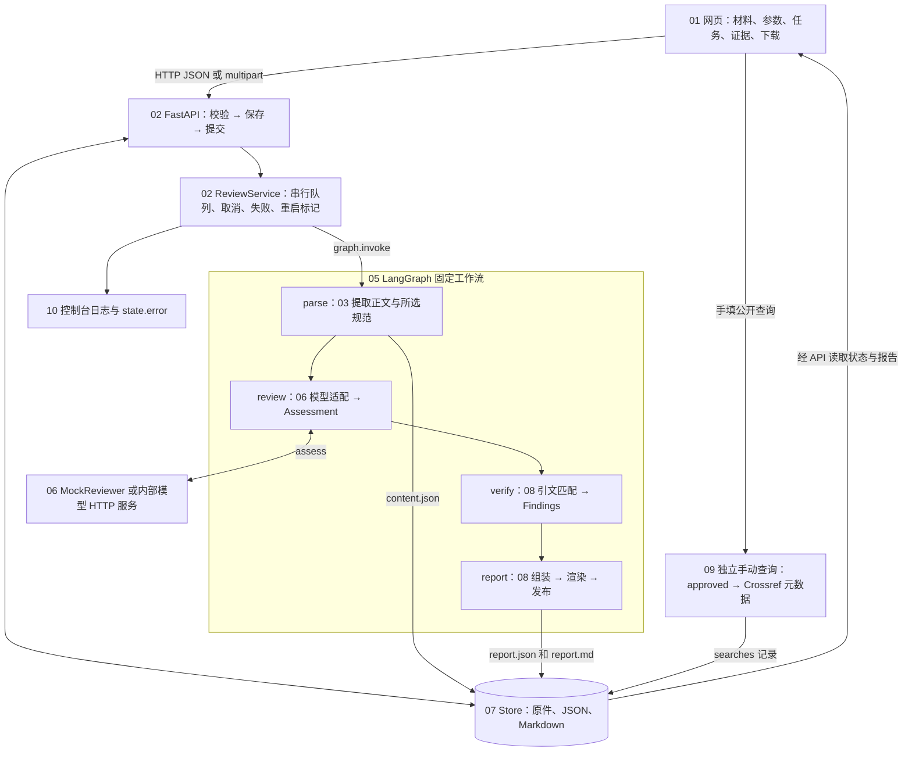
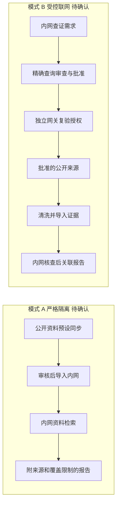

# 内网论文自动评审工具技术方案

版本：V0.1　状态：待方案确认　日期：2026-11-08  
对应项目：`thesis_review_agent`　适用读者：业务负责人、技术负责人、模型部署及内网运维人员

## 1 方案摘要

建议采用**网页入口 + FastAPI 业务接口 + LangGraph 工作流 + 内部模型服务 + 本地文件存储**。当前开发环境继续使用模拟模型完成工程验证；进入内网后按相同协议替换为参数量大于 8B 的真实模型。单张 A100 先采用串行评审，暂不引入数据库、消息中间件或分布式任务系统。

现有 demo 已实现 `parse → review → verify → report` 四节点执行链，以及上传、规范选用、取消、历史查询和报告下载。本方案保留这些模块与契约，逐步补齐 OCR、长文处理、规范适用性确认及公开资料查证。模型服务、完整学术评审效果和内网隔离尚未完成实机验证。

本方案配套《需求文档》，R01—R12、N01—N05 和 D01—D08 编号沿用需求文档。**本次请求确认技术路线、首期范围、联网方式、资源与验收责任；不是申请将当前 demo 直接作为正式共享服务发布。**

## 2 现状与设计选择

| 设计点 | 采用方式 | 原因与边界 |
| --- | --- | --- |
| 用户入口 | 原生 HTML／CSS／JavaScript 网页 | 便于上传和查看证据，当前不需要前端构建链 |
| 业务服务 | Python／FastAPI，接口前缀 `/api/v1` | 输入与响应结构明确；通过 `/docs`、`/openapi.json` 协作 |
| Agent 编排 | LangGraph StateGraph，固定四节点 | 阶段显式、错误可定位；无需为接入框架重写解析和模型模块 |
| 任务调度 | 一个后端进程、一个后台评审线程 | 符合单卡低并发起点；多个任务排队，不并行推理 |
| 模型协议 | OpenAI-compatible Chat Completions | 复用现有 LocalReviewer；正式模型型号和推理服务待内网验证 |
| 持久化 | `DATA_ROOT` 下的 JSON 和原始文件 | 当前无数据库环境；任务材料和产物可直接定位 |
| 任务进度 | 页面每 1.5 秒轮询 | 简化 demo；SSE 不作为首期依赖 |
| 查询能力 | 当前为独立手动批准的 Crossref 元数据查询 | 不自动从论文生成查询，不自动合并到报告；正式方案按联网模式扩展 |
| 故障处理 | 明确失败，无云模型回退和多轮自动修复 | 保留错误原因，避免在不知情情况下改变模型或评审范围 |

“本地 agent”由工作流、内部模型和受控工具组成。LangGraph 是编排框架，不是推理模型或可离线部署的 Codex 模型。当前未使用 Codex CLI，也没有模型自主返回 tool_calls 并循环执行工具的能力。

## 3 整体架构与模块职责

### 3.1 当前可运行链路



模块 04 当前没有独立检索服务：所选规范由模块 03 提取后直接进入评审上下文。上图中的内部模型 HTTP 接口已实现，真实模型服务仍待部署。

### 3.2 十个模块及资源

以下资源为低并发部署的初始规划，不是实测最低配置。CPU／RAM 可在同一主机共享，不能把每行机械相加；GPU 使用需统一调度。

| 模块 | 职责及内部流程 | 实现与协作接口 | 资源起点 |
| --- | --- | --- | --- |
| 01 材料入口 | 上传／粘贴 → 设置尺度 → 提交 → 查看进度、证据和报告 | `app/static/`；调用模块 02 的 HTTP API | 普通浏览器，无 GPU |
| 02 业务与调度 | 校验 → 存储 → 排队 → 调用图；处理取消、失败和重启 | `main.py`、`schemas.py`、`service.py`；调用 Store、graph.invoke | 2–4 vCPU、4–8GB RAM，与 05 共用 |
| 03 文档解析 | 按格式提取 → 生成位置 → 返回块与警告 | `parsing.py`；`parse_document(store, id)`；未来增加本地 OCR／版面适配器 | 4–8 vCPU、8–16GB RAM；OCR 是否用 GPU 依选型实测 |
| 04 规范与检索 | 目标：确认规范 → 按适用条件筛选 → 检索条款／文献 → 返回来源 | 当前仅所选规范全文；未来 `retrieve_rules/retrieve_literature` | 2–4 vCPU、4–8GB RAM；向量模型可先用 CPU |
| 05 评审编排 | parse → review → verify → report，传递状态与限制 | `workflow.py`；调用 03、06、08，并通过 02 更新任务状态 | 与 02 共用 CPU，无独立 GPU 需求 |
| 06 模型服务 | 接收内部上下文 → 推理 → 输出 Assessment | `review.py` 中的 MockReviewer／LocalReviewer；内部 HTTP 兼容服务，候选为 vLLM 等 | 一张 A100；主机 RAM 初步 64–128GB；模型与显存容量待验证 |
| 07 数据存储 | 保存原件／元数据 → 按 ID 读取 → 发布产物 | `storage.py`；`save_document/read/write/update_job`；未来按接口替换存储 | 本地 SSD；缓存和文件操作与应用共用 CPU／RAM |
| 08 校验与报告 | 引文匹配 → 排序 → 补充位置／覆盖 → JSON／Markdown | `review.py`、`workflow.py`；未来增加数值与语义复核 | 约 2 vCPU、2–4GB RAM；语义复核可复用 06 |
| 09 联网网关 | 目标：核准精确查询 → 限制出站 → 获取证据 → 回流 | 当前 `search.py` 为同一后端直接查询；未来独立网关和授权协议 | 受控联网时建议独立 2–4 vCPU、4–8GB RAM、20–50GB SSD，无 GPU |
| 10 安全与运维 | 目标：身份／访问隔离 → 出网策略 → 审计 → 备份／删除 | 当前只有本机绑定、输入校验、运行日志及关闭评审云追踪 | 共享约 1–2 vCPU、2–4GB RAM，备份空间另计 |

内网主机可暂按 16–24 vCPU、128GB RAM、1–2TB SSD 加现有 A100 预留，最终按材料保留量和实测调整。A100 的 40GB／80GB 容量尚未确认，不据此承诺某一大模型或精度一定可用；显存预算须包含权重、KV cache、上下文长度、批量和运行时开销。无需为当前模拟 demo 配备 GPU。

### 3.3 后续目标链路

完整审查增加“版面与 OCR → 分章评审 → 数值及语义核查 → 跨章汇总”，保留原有模块职责；工具只提供特定数据读取、计算和检索能力，不向模型开放任意 shell 或任意网络请求。

| 后续能力 | 实施位置 | 重要约束 |
| --- | --- | --- |
| OCR 与图表处理 | 03 的本地适配器，可评估 Docling 等方案 | 原始材料不发云端；保留页与区域位置，不把识别文本当成正确结果 |
| 长文审查 | 05 增加章节计划、分章调用和跨章汇总 | 明确每章覆盖及未审范围，不能只拼接摘要或静默截断 |
| 规范适用性与资料检索 | 04 及 07 | 发布人确认文件、版本、生效期和适用对象；引用真实条款 |
| 数值与证据复核 | 08，可调用 06 或限定计算工具 | 程序记录计算输入、单位与输出；区分字面证据和结论支持 |
| 自主工具调用 | 05 的有限循环、06 的 tool_calls 协议 | 仅 D05 批准后实施；需限定工具、参数、次数、超时和权限 |

## 4 LangGraph 执行与状态

### 4.1 节点契约

`ReviewService` 初始化时调用 `build_workflow(store, settings, self.advance)` 并编译一次。后台线程对每个任务调用 `graph.invoke({"job_id": identifier, "request": request})`，执行 `START → parse → review → verify → report → END`。

| 节点 | 输入 | 输出与副作用 |
| --- | --- | --- |
| parse | job_id、ReviewRequest 的 document_ids／policy_ids | 解析正文和规范；返回 blocks、policies、warnings，写 content.json；无正文时失败 |
| review | request、blocks、policies | 调用现有评审适配器，返回 assessment；当前只调用一次模型 |
| verify | assessment、blocks | 检查 block_id 存在及 quote 是原文子串，返回按 major 优先排序的 findings；不匹配则失败 |
| report | request、assessment、findings、blocks、warnings、policies | 补充真实位置、覆盖与限制；写 report.json／report.md，发布 completed／partial |

`ReviewState` 为内存 TypedDict，字段包括 job_id、request、blocks、policies、warnings、assessment、findings。节点返回更新字段，LangGraph 合并后传给下一节点；每次调用状态独立。request、assessment、findings 在内存中保留 Pydantic 对象，写文件时转为 JSON。

**磁盘 state.json 是页面使用的任务状态，不是 LangGraph 检查点。** 当前不配置 checkpointer，不保存逐节点快照，不提供 resume、自动重试或 Run 历史。

### 4.2 取消与故障

| 类型 | 规则 |
| --- | --- |
| 正常状态 | queued → running → completed 或 partial |
| 阶段 | queued → parsing → reviewing → verifying → reporting |
| 取消 | 每个节点入口经 `advance(job_id, stage)` 检查；已取消则抛 ReviewCancelled，由 service 正常结束 |
| 发布保护 | report 在锁内再次检查取消；两种报告写完后才更新完成状态 |
| 模型请求 | 已发出的 HTTP 请求可能持续到返回或超时，取消不等于强制终止远端推理 |
| 失败 | 普通异常记录 Job ID、堆栈及 state.error；标记 failed；已取消状态不被失败覆盖 |
| 重启 | 发现遗留 queued／running 标记 interrupted，用户重新提交新任务 |
| 有限范围结果 | 当前任何解析警告或 mock 模式都会产生 partial；completed 不表示论文合格或完整合规 |

评审执行使用 `tracing_context(enabled=False)`，即使环境变量已开启 LangSmith 追踪，也关闭本次图执行的云端追踪。此措施不替代正式部署的网络级隔离与组件检查。

## 5 模块接口与通信协议

### 5.1 公共约定

- 前端与应用：同源 HTTP REST，业务内容为 UTF-8 JSON，文件上传为 multipart/form-data；正式共享部署增加内网 HTTPS、身份及访问控制。
- 后端模块：同一进程内使用 Python 函数与对象，无额外 RPC 层；模型服务、公开搜索分别走 HTTP／HTTPS。
- 标识：`doc_`、`job_`、`search_` 加 UUID 十六进制；块 ID 为 `<document_id>:b<N>`。时间为带 UTC 偏移的 ISO 8601。
- 错误：通常为 `{"detail":"具体原因"}`；422 的 detail 为字段校验列表。后台错误通过任务查询读取，不改变已返回的 202。
- 当前无分页、幂等键、全局 request_id 或 revision；重复提交创建新资源。未来变更需同步前端和文档，不能假定已支持。

### 5.2 当前 HTTP API

下表路径统一加前缀 `/api/v1`。

| 方法与路径 | 请求 | 响应与用途 |
| --- | --- | --- |
| GET `/config` | 无 | 200；模型是否配置、模型名称、OCR=false、存储和版本 |
| POST `/documents` | multipart：file、role=primary/policy | 201 Document；支持 PDF／DOCX／TXT／PNG／JPG／JPEG，非空且不超过 30MiB |
| POST `/documents/text` | JSON：title、text | 201 Document；以 UTF-8 TXT 保存；title ≤200 字符，text 1–500000 字符且不能全为空白 |
| GET `/documents` | 无 | 200 Document[]，按创建时间倒序 |
| GET `/documents/{id}/content` | 文档 ID | 200 原文件，用于下载 |
| POST `/jobs` | ReviewRequest | 202 初始 JobState；后台执行 |
| GET `/jobs`、GET `/jobs/{id}` | 无／任务 ID | 200 任务列表／状态，供页面轮询 |
| POST `/jobs/{id}/cancel` | 无业务请求体 | 200 状态；终态不改变 |
| GET `/jobs/{id}/content` | 任务 ID | 200 blocks、policies、warnings；解析产物未生成时 404 |
| GET `/jobs/{id}/report` | 任务 ID | 200 Report；仅 completed／partial 可读，否则 409 |
| GET `/jobs/{id}/download` | 任务 ID | 200 Markdown 文件；同报告发布条件 |
| POST `/search` | query 2–300 字符，approved=true | 200 SearchRecord；false 返回 403；外部查询失败返回 502 |

其他主要状态码：400 表示输入／配置问题，404 表示资源不存在，422 表示请求结构不合法。`/docs` 与 `/openapi.json` 是运行时接口依据。

创建任务示例，ID 为占位说明，应替换为上传响应的真实 ID：

```json
{
  "document_ids": ["doc_<uuid>"],
  "policy_ids": [],
  "material_type": "thesis",
  "degree": "master",
  "language": "zh-CN",
  "custom_prompt": "重点核查实验条件及图表与正文的一致性。",
  "model_mode": "mock"
}
```

| 字段 | 类型与约束 |
| --- | --- |
| document_ids | string[]，1–10 个已保存材料 ID |
| policy_ids | string[]，0–10 个参考规范 ID，默认空 |
| material_type | proposal／progress／thesis／paper，默认 thesis |
| degree | bachelor／master／doctor／unknown，默认 master；专业学位字段待补 |
| language | zh-CN／en，默认 zh-CN；当前由用户选择 |
| custom_prompt | string，默认空，≤10000 字符；只调整评审重点 |
| model_mode | mock／local，默认 mock；前端不能传入模型地址或密钥 |

### 5.3 内部函数接口

| 调用 | 输入 → 输出 | 职责归属 |
| --- | --- | --- |
| Store.save_document | filename、bytes、role → Document | 07 保存原件和元数据 |
| ReviewService.submit | ReviewRequest → queued JobState | 02 保存请求并排队 |
| graph.invoke | job_id、request → 最终内存状态；报告已由节点落盘 | 05 执行四节点；service 不依赖返回值发布报告 |
| advance | job_id、stage → bool | 02 更新执行状态或阻止已取消任务继续 |
| parse_document | Store、document_id → blocks、warnings | 03 解析；05 区分正文与规范并合并警告 |
| MockReviewer／LocalReviewer.assess | request、blocks、policies → Assessment | 06 模拟检查或真实模型协议 |
| validate_evidence | Assessment、blocks → Finding[] | 08 引文存在性与排序 |
| markdown | Report → string | 08 格式化输出 |
| search_public | 公开 query → 元数据结果列表 | 09 独立查询；不接收任务正文 |

### 5.4 模型服务契约

通过环境变量配置 `MODEL_BASE_URL`、`MODEL_NAME`、可选 `MODEL_API_KEY`；例如 base URL 指向可信内网地址并以 `/v1` 结尾。现有程序不会自动判断配置地址是否属于内网，需由管理员及网络策略保证。

```text
POST {MODEL_BASE_URL}/chat/completions
Content-Type: application/json
Authorization: Bearer <key>   # 仅配置密钥时发送
超时：180 秒

请求：
  model: 配置的模型名
  temperature: 0.1
  messages: [system, user]
  response_format: {"type": "json_object"}

user.content 是 JSON 字符串：
  request + blocks + policies + output_schema

响应：
  choices[0].message.content 必须是合法 Assessment JSON
```

当前序列化 user 内容超过 60000 字符即拒绝，计算范围包括请求、材料、规范及输出 Schema；这不是模型 token 上限或全文支持承诺。不支持 Markdown 围栏和 tool_calls 响应，不自动修复非法 JSON。

Assessment 字段为 verdict、summary、findings、priority_actions。verdict 为“基本满足／需修改／存在重大问题／信息不足”；Finding 结构见第 6 节。`response_format=json_object` 不能代替 Pydantic 字段校验，也不能保证学术结论正确。

内网模型团队需验证结构化输出、中文学术文本、英文小论文、有效上下文、超时和资源峰值。具体模型及量化方式不在本版写死；大于 8B 只是已确认约束，不能代替质量评估。如需要自主工具调用，应另行确认模型格式、服务解析器和工具执行协议。

## 6 本地文件与字段设计

### 6.1 当前目录

默认目录为代码根目录下的 `data/`，可以通过 `DATA_ROOT` 指定绝对路径。原件仅保存一次，任务通过文档 ID 引用。

```text
data/
  documents/<doc_id>/
    document.json
    source.ext
  jobs/<job_id>/
    request.json
    state.json
    content.json
    report.json
    report.md
  searches/<search_id>.json
```

正常完成任务最多产生上述五个任务文件；失败或取消任务可能只有部分产物。JSON 写入时会短暂生成同名 `.tmp` 文件再替换，不额外保存模型调用历史快照。数据目录已排除在版本控制之外。

### 6.2 当前字段字典

| 文件或对象 | 保存字段与含义 |
| --- | --- |
| document.json | id；filename 显示文件名；suffix；role=primary/policy；size_bytes；sha256 原件哈希；created_at |
| source.ext | 原始字节；粘贴文本为 source.txt；图片当前只保存，不执行 OCR |
| request.json | 第 5 节 ReviewRequest 的完整字段；不复制原件 |
| state.json | id、title 首份材料名、created_at、updated_at、status、stage、error:string/null、mode:mock/local |
| content.json | blocks:正文块数组；policies:规范块数组；warnings:提取警告数组 |
| Block | id、document_id、filename、location、text；位置为 PDF 物理页、DOCX 段落／表格行、TXT 行 |
| Assessment | verdict、summary:string、findings:Finding[]、priority_actions:string[]；当前只在内存中独立存在 |
| Finding | dimension:结果可信度／内容可靠性／规范与逻辑／创新与价值；severity:major/minor；status:supported/pending_verification；block_id；quote 非空原文；issue；suggestion |
| report.json | Assessment 全部字段，加 schema_version="1.0"、job_id、mode、model_name、generated_at、limitations:string[]、coverage；每项 finding 增加 filename/location |
| coverage | block_count、document_count、scope="extracted_text_only"；不是四维检查完成率 |
| report.md | 固定报告格式；由 report.json 对应数据渲染，附审查限制 |
| SearchRecord | id、query、approved=true、created_at、results；每条结果为 title、doi、url、scope="metadata_only" |

severity 与 status 含义不同：前者表示问题影响，后者表示依据状态。当前 `supported` 不代表经过独立语义审查，程序只保证引文能在给定块找到。报告阅读者仍需核查推论。

当前没有 bbox、字符偏移、独立 parse_id、evidence_id、run_id；DOCX 不生成页码，PDF 位置指实际物理页序。不要向现有接口传入仅在完整架构中规划的字段并假定生效。

### 6.3 写入与恢复规则

1. 先保存原件和 document.json，再创建 request.json 与 queued state.json。
2. 解析后写 content.json；评审与引文校验完成后组装报告。
3. 在进程锁内检查取消，写 report.json、report.md，最后更新完成状态。
4. API 只在 completed／partial 时提供报告；失败不会自动补齐产物，重启不会自动恢复推理。

JSON 通过临时文件 replace 提供单文件替换，不能保证多个文件的事务或断电持久性。RLock 只保护当前进程，因此必须运行一个服务实例，禁止多个实例同时写同一数据目录。备份建议在暂停任务写入的维护窗口执行；保留、删除和恢复规则由 D07 确认，当前未提供相关管理 API。

### 6.4 后续数据扩展

仅在批准对应能力后增加必要字段，不预先实现整套版本系统：

| 触发需求 | 拟增加数据 | 迁移约束 |
| --- | --- | --- |
| 规范发布与适用性 | policy_version_id、来源、发布日期／有效期、单位、学位／阶段、确认人 | 历史任务记录实际使用版本，不读取随时变化的“最新规范” |
| OCR／分章与定位 | parse_id、章节／页／区域位置、解析器与版本、来源哈希、未解析范围 | 新解析版本不覆盖历史证据位置 |
| 查证回流 | evidence_id、source_type、source_ref、获取时间、content_scope、引文与验证状态；问题关联 evidence_ids | 单独区分元数据、摘要和全文证据 |
| 审批与审计 | search_request_id、精确查询哈希、审批人、有效期、执行结果；operator、request_id、操作时间 | 批准和实际查询必须一致；日志避免无必要地复制全文 |
| 多用户或正式复现 | owner_id、权限归属；模型、提示词、规范和工作流版本 | 不能把当前 model_name 当成完整可复现配置 |
| 重试／续跑／数据库 | job_id 下增加 run_id、检查点及输入配置哈希，或迁移数据库 | 仅兼容的输入与配置允许恢复；明确事务和并发控制后再切换 |

## 7 联网与论文保密方案

### 7.1 两种模式



模式 A 不允许当前论文任务产生公网查询；外部资料同步与当前论文无关。若采用该模式，应确认“实时联网搜索”调整为“预先导入公开资料后检索”，并接受更新和覆盖限制。

模式 B 允许经批准的公开查询，但禁止发送论文原文、内部题目／项目、实验数值、图片和完整提示词。即使查询由公开词语组成，也可能暴露研究方向，不能只靠关键词过滤宣布安全。

### 7.2 当前查询与目标网关协议

当前调用为 `GET https://api.crossref.org/works?query.bibliographic=<URL编码query>&rows=5`，超时 20 秒。程序提取 title、DOI、URL，标记 metadata_only 并保存。它是用户手工操作的独立功能；没有自动 query 生成、查询审批记录、全文阅读或结果入报告流程，approved 布尔值也不是多用户身份授权。

受控网关拟只接收下列字段；这是设计契约，尚无对应实现：

| 字段 | 用途 |
| --- | --- |
| request_id | 随机外部请求标识，不使用内部 Job ID |
| query | 获批的精确公开查询 |
| allowed_domains、max_results | 限定目标与返回规模 |
| release_token | 短期签名授权，绑定查询哈希、允许目标和有效期 |

网关核验签名与查询一致性，限制域名、重定向、返回大小、频率及内网地址访问。结果经清洗后以来源、获取时间和内容范围进入内网证据库，只有完成核查的证据才能用于相应结论；失败或证据不足则保留待核实。

无论采用哪种模式，论文及检索网页中的命令都作为数据处理，不能改变工具权限。正式部署还需离线导入依赖和权重，确认 OCR、向量模型、字体／前端资源、日志和备份均遵守边界，并检查外部遥测及自动下载。仅关闭 LangSmith 追踪不足以证明整个系统没有出网。

## 8 当前限制及处理方式

| 限制 | 影响 | 处理方式 |
| --- | --- | --- |
| mock 仅检测 TODO 等标记 | 不具备四维学术评价能力 | 仅用于工程演示，内网真实模型通过专家验证后才进入业务试点 |
| PDF 仅文本；DOCX 未完整提取公式、脚注及图片 | 图表、公式和版面不能完整核查 | 报告明确未审范围，M2 接入本地解析能力 |
| 单次上下文 60000 字符限制 | 长篇学位论文可能无法完整提交模型 | 当前拒绝超限；M2 分章并做跨章审查，不静默截断 |
| 原文子串校验 | 能定位引用，但无法证明解释、推论和创新判断正确 | 结合程序计算、来源查证和人工复核逐步增强 |
| 语言与学位字段不完整 | 英文报告可能混有中文固定内容；专业学位尺度不能单独标记 | 补充字段和完整本地化测试 |
| 当前请求超时／取消不终止远端模型 | 取消后可能仍占用 GPU | 单卡排队起步；后续评估模型服务取消接口，现阶段保证结果不发布 |
| 无数据库、权限和跨进程锁 | 不适合直接开放为多人、多实例服务 | 试点先明确使用边界；多人开放前补权限；有真实需求再迁移存储 |
| 规范、模型及配置版本未完整冻结 | 难以严格重现历史评审 | 正式试点按复核要求补最小版本记录，不把 demo 视为完整审计系统 |

## 9 实施与跨环境协作

### 9.1 阶段和交付物

| 阶段 | 应用侧工作 | 内网及业务侧工作 | 阶段交付与退出条件 |
| --- | --- | --- | --- |
| M0 本地 demo | 保留已有界面、工作流、存储和测试 | 确认演示流程与需求差距 | 当前代码、README、架构图和本次两份确认文档；不作为模型效果验收 |
| M1 内网文本试点 | 维护模型契约；补试点必须的规范／版本／访问能力；联调真实模型 | 提供 A100 环境、模型服务、规范和已授权样本，落实网络策略 | 模型契约、样本报告、资源测量、专家复核和隐私验证记录 |
| M2 完整输入与查证 | OCR、分章／跨章、语种、证据复核、查证关联；按已批准模式扩展 | 提供扫描／图表样本；落实资料导入或联网网关及批准人 | 按需求 A01—A10 完成批准范围验收，登记残余限制 |
| M3 按需扩展 | 数据库、多实例、重试、检查点、向量索引或 SSE | 按实际业务规模提供运维条件 | 独立变更范围、迁移方案及测试记录 |

阶段没有预设工期承诺。完成 D01—D08 确认、模型资源及样本到位后，再依据工作量和责任人确定交付窗口。

### 9.2 不在内网时的协作方式

1. **先对齐契约**：共享代码、依赖清单、OpenAPI、示例 JSON 和错误语义；固定版本后两侧独立实现，不依赖远程访问论文。
2. **应用侧独立开发**：使用模拟器、公开或人工构造的材料验证上传、状态、存储、取消及失败流程；不要求复制真实内部论文到外部开发机。
3. **内网侧部署验证**：部署符合第 5.4 节协议的模型，设置 MODEL_BASE_URL／MODEL_NAME，检查网络和存储位置；真实材料只在内部测试。
4. **反馈最小必要信息**：返回经批准的错误类别、脱敏协议样例、耗时／显存指标和专家问题归类；避免直接传回含论文片段的日志、提示词或报告。
5. **替换与迁移**：维持 LocalReviewer 和 Store 的模块边界。后续数据库先实现等价存取语义与迁移检查，再替换后端；不让页面或模型模块直接依赖数据库表。

## 10 验证依据与上游确认

现有 12 项自动化测试已有通过记录，覆盖报告持久化、DOCX 提取、无 OCR 图片失败、取消、图阶段和规范传递、任务间隔离、错误引文、搜索批准、资源错误、重启中断及禁用云追踪。本次文档编制核对了代码和测试范围，未新增 A100、真实模型或网络隔离实测结果。

后续验收按需求文档 A01—A10 执行，分为工程流程验证、模型与专家样本验证、内网部署与性能验证。报告可生成不等于评审正确；请求成功不等于全文已审；部署在内部也不自动等于不存在外部数据通道。

| 确认编号 | 方案侧需要落实的结果 |
| --- | --- |
| D01 首期范围 | 是否按 M1 文本试点推进；是否把 OCR、长文、自动查证提前列为首期必需 |
| D02 联网模式 | 选 A 或 B；明确实时搜索是否允许，以及资料导入／查询批准负责人 |
| D03 资源与模型 | A100 显存、主机和驱动条件；模型候选、精度、上下文、服务协议及资源测量计划 |
| D04 规范 | 文件清单、版本、适用机构／阶段／学位及维护人 |
| D05 自主工具调用 | 固定四节点是否满足首期；如不满足，批准具体工具、权限和调用预算 |
| D06 验收 | 样本、专家、判定规则、误报漏报容忍度、篇幅和性能目标 |
| D07 数据与访问 | 用户范围、认证方式、数据目录权限、保留／删除／备份／恢复规则 |
| D08 分工与排期 | 应用、模型、运维安全、业务专家负责人及资源到位时间 |

建议确认后冻结 V1.0 的需求与方案基线；本版中的候选组件、估算资源和未来字段均不自动视为已批准交付项。

## 11 配套材料

- [需求文档](需求文档.md)：业务要求、范围、验收用例与完整待确认清单。
- [README](../README.md)：启动方法、当前 API 与实现说明。
- [完整架构 SVG](architecture.svg)：十个模块、硬件、接口、协议和本地字段详图；上半部为目标架构，下半部为当前实现与协议。
- 代码基线：`app/workflow.py`、`service.py`、`main.py`、`schemas.py`、`review.py`、`parsing.py`、`storage.py`、`search.py`，依赖以 `requirements.txt` 为准。

正文中的 Mermaid 图和表格已包含方案确认所需内容；单独转发本文时无需同时附上本地代码或论文数据。阅读器不支持 Mermaid 时，可按节点表和接口表查看同一流程。
