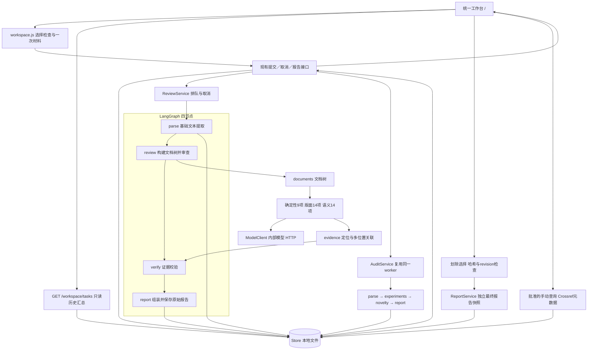
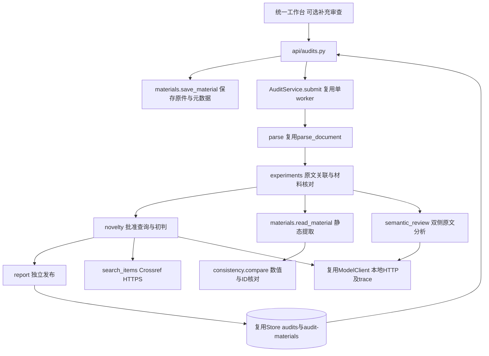

# 学位论文自动审查系统技术方案

日期：2026-11-16　应用接口版本：0.1.0

## 1 架构

网页、FastAPI、LangGraph、内部模型HTTP服务和本地文件存储组成审查链路。应用单进程、单后台评审worker；任务内部部分正文批次最多并发两个模型请求。没有数据库、消息队列或LangGraph Server。

HTTP路由负责输入输出，任务服务管理生命周期，解析器按格式构建文档树，检查器生成问题与逐项状态，证据与报告模块处理来源和人工复核。使用普通函数和直接参数传递。

统一工作台位于`/`，`/audit`返回相同页面；可选补充审查位于`app/audit/`。AuditService复用ReviewService的同一个worker、Store及ModelClient，运行独立四节点图，产物放在独立目录；旧ReviewRequest、37项规则、报告结构、取消语义及启动方式保持不变。

## 2 当前流程



[完整架构 SVG](architecture.svg) 同时展示模块内部职责、硬件预算、API、协议、状态、字段和两种未来联网模式。图中的已实现／待建设标记是能力边界，不代表内网实机部署结果。

## 3 模块职责与资源

资源是低并发起点估算，可共享而不应逐行叠加；尚未完成A100压测。

| 模块 | 职责与实现 | 硬件／交互 |
| --- | --- | --- |
| 01 网页 | workspace.js统一材料、选项、历史与页签；app.js原报告；audit.js补充材料和报告；review.js复核；evidence.js证据 | 普通浏览器，无 GPU；HTTP 调 02 |
| 02 接口与调度 | api/ 路由；jobs.py 单线程生命周期；main.py 应用工厂 | 2–4 vCPU／4–8GB RAM，与 05 共用；调 Store 和图 |
| 03 解析 | documents/parser.py基础文本；pdf/docx/text格式构建；pdf_blocks/pdf_elements/pdf_finalize分步处理；models文档树与headings等辅助 | 4–8 vCPU／8–16GB RAM；本地 PyMuPDF、pypdf、python-docx、fonttools；无 OCR |
| 04 规范与资料 | 当前仅解析所选 policy 文件并保存；独立检索／发布尚未实现 | 未来 2–4 vCPU／4–8GB RAM；向量模型可先 CPU，不是当前依赖 |
| 05 编排与审查 | workflow.py四节点；review/engine.py汇总；semantic协调semantic_tasks；reading及coverage_intro/body保留阅读协议与补查；verdict原始结论 | 与 02 共用 CPU；semantic_tasks及coverage_body/intro调06，不依赖 HTTP 路由 |
| 06 模型 | model_client.py 请求、JSON 解析、调用记录；规则自行组织切片和提示词 | 现有一张 A100，型号／精度／上下文需实测；主机 RAM 初估64–128GB；HTTP兼容 |
| 07 存储 | storage.py 保存原件、JSON、Markdown、复核与快照；RLock、单文件 replace | 本地 SSD、共享 CPU/RAM；仅单实例写入，不提供多文件事务 |
| 08 证据与报告 | evidence/定位、验证、截图；reporting/原始渲染、复核服务和最终报告 | 约2 vCPU／2–4GB RAM；截图为按需 PNG，不改原 PDF |
| 09 搜索 | search.py 用户批准后直接取 Crossref 元数据 | 当前同一后端；目标独立网关2–4 vCPU／4–8GB RAM／20–50GB SSD |
| 10 安全运维 | 当前本地配置、错误日志、图云追踪关闭；身份、审计、隔离网关待建设 | 共享约1–2 vCPU／2–4GB RAM；离线依赖、网络和备份由管理员落实 |
| 11 补充材料 | audit/materials.py静态解析；consistency.py字段核对、ID重叠、模型双侧引文 | 共享CPU/RAM，输入最多10MiB/份；不执行上传代码，不需要训练GPU |
| 12 创新性初判 | audit/novelty.py检索登记、书目／摘要比较及来源准入 | 复用09、06；只向Crossref发送批准的精确查询 |
| 13 补充编排与报告 | audit/service.py生命周期及四节点图；audit/reporting.py独立Markdown | 复用单worker、07、06；与37项报告及人工复核隔离 |

完整内部主机可先预留 16–24 vCPU、128GB RAM、1–2TB SSD 加 A100，最终按存量、篇幅、模型缓存和并发实测。A100 显存容量未在实机核实，不承诺某一27B模型精度可装载。脚本中的模型名只是原环境配置，不证明权重真实身份或部署效果。

## 4 模块内部契约

| 调用 | 输入 → 输出／副作用 |
| --- | --- |
| Store.save_document | filename、bytes、role → Document；保存原件及 document.json |
| ReviewService.submit | ReviewRequest → queued JobState；保存请求并提交单线程队列 |
| graph.invoke | job_id、request → 内存 ReviewState；产物由节点写 Store |
| parse_document | store、document_id → blocks、warnings；正文与规范分别累积，写 content.json |
| 文档树构建 | 原文件路径或 blocks → ThesisDocumentTree；原文件取首份主材料 |
| NegativeChecklistReviewer.assess | request、blocks、policies、可选source_path/tree → Assessment；调用三检查器并关联证据 |
| SemanticChecker._call_llm | prompt、model_mode → 交给 ModelClient；规则和覆盖测试仍可替换此入口 |
| ModelClient.call | prompt、mode → 结果字典或错误字符串；请求内部模型并写本地 trace |
| validate_evidence | Assessment、blocks → Findings；可尝试匹配或保留待核实，不统一抛错 |
| markdown | Report → Markdown；原始与最终报告复用 |
| ReportService | get／decisions／save_decisions／final；读取原报告、检查哈希和修订、写复核与快照 |
| render_evidence_page | PDF路径、location、full_page → PNG bytes；默认裁切上下文，可返回整页 |
| search_public | 已批准公开 query → 最多5条书目元数据；独立于图执行 |

底层文档数据模型不依赖路由、队列或存储实现。解析辅助 formula_symbols 同时供文档构建和规则检查使用。规则不执行任意 shell、用户路径或网络工具；当前没有自主 tool_calls 执行循环。

## 5 文档结构与检查策略

### 5.1 格式与任务分工

- documents/pdf.py、docx.py、text.py分别负责PDF、DOCX和文本格式解析；包入口导出这三个构建函数。
- pdf_blocks.py：image_bounds、read_regions、text_blocks、paragraph_blocks、paragraph_from_block，顺序保留；按已定义的字号与间距规则合并。
- pdf_elements.py：将识别出的图表、公式挂到当前章节；pdf_finalize.py：页面留白、公式上下文、跨页续接与总结篇幅。
- headings.py：归一化、封面标题、章节／目录识别辅助。PDF章节、摘要、参考文献切换仍由pdf.py按原状态顺序处理。
- semantic_tasks/：abstracts、introduction、chapters、formulas、conclusion五个普通任务函数，common承载共用引文定位和文本比较；SemanticChecker按固定顺序调度。
- reading.py：Piece、分批、请求格式、引文定位与覆盖记录；coverage_intro.py负责8/9，coverage_body.py负责37/38，并将来源准备、批次请求、记录索引、整章复核分为具名函数。调用者直接引用实际实现模块。

模型调用元数据记录参与检查的源码哈希，便于定位实际执行版本。

### 5.2 两条解析路径

基础 parser 提取用于 content.json 的文本块：PDF按物理页、DOCX按段落／表格行、TXT按行编号。它保留原有警告，包括 PDF 尚未完整视觉验证和 DOCX 特殊内容未提取。

review 节点再从首份原文件构建文档树：页面、行、字体、段落、章节、摘要、图表、公式、参考文献、总结等。PDF包括图文区域识别、运行页眉页脚排除、段落续接、部分字体字形及公式恢复。没有原文件时使用 blocks 构建简化树。两条路径暂未统一，多材料和坐标体系不应假设全部一致。

### 5.3 三类检查与覆盖

确定性9项、版面14项、语义14项，总计37条。每项独立生成 RuleAuditItem，不以缺少问题自动表示通过。

规则8/9对完整首章分片读取，要求有效记录后综合判断；规则37/38将正文切为保留偏移的 Piece，批次检查并核对原文锚点及返回ID。正文批次最多并发2个请求，按来源顺序汇总。模型空返回、重复ID、记录缺失和引文不匹配不会自动记作可靠阅读。

这不是所有37条均全量调用模型。部分任务取有限片段，部分仍使用关键词或规则；coverage 模块对格式错误可能再请求一次，对部分未完整记录有局部补查，原有策略保持。模型字数覆盖仅表示协议记录，不证明理解正确。

### 5.4 证据与结论

证据关联支持多位置、跨页段落到物理页的映射、字符偏移和多个矩形，截图按原 PDF 坐标绘制红框。bbox 为 PDF 页面坐标，并非早期目标设计中的0–1归一化坐标；当前没有全局统一 locator 版本。

verified 仅表示来源可匹配，pending_verification 表示仍需核对。validate_evidence 对已验证位置、有效块ID可直接接受；否则尝试引文和位置匹配，无匹配会清空块ID，并可能标记待核实，不伪造首段位置。它不验证数据真实性或推论成立。

原始结论阈值为 major≥3 判重大、其他有问题判需修改、无问题但未完成判信息不足；最终报告保留 major≥1 即判重大。后者仍保留原始信息不足、mock或未解决项的限制。分别保存在 review/verdict.py 和 reporting/final.py，两者判定口径尚待确认。

## 6 HTTP 接口

接口路径、方法、状态码和结构以运行时OpenAPI为准。全表统一加前缀 `/api/v1`；ID 是资源前缀加32位UUID十六进制；时间为UTC ISO 8601。JSON UTF-8，上传 multipart，下载原文件／Markdown／PNG；开发时HTTP同源，正式HTTPS及认证待建设。

| 方法／路径 | 输入与返回 |
| --- | --- |
| GET `/config` | 模型可用配置、名称、OCR=false、存储和应用版本 |
| POST `/documents` | file、role=primary/policy → 201 Document；默认100MiB，非空 |
| POST `/documents/text` | title≤200、text 1–1000000且非空白 → 201 Document |
| GET `/documents` | Document[]，创建时间倒序 |
| GET `/documents/{identifier}/content` | 原文件下载 |
| POST `/jobs` | ReviewRequest → 202 queued状态 |
| GET `/jobs` | JobState[]，无分页 |
| GET `/jobs/{identifier}` | JobState |
| POST `/jobs/{identifier}/cancel` | 200 当前状态；终态不改 |
| GET `/jobs/{identifier}/content` | blocks、policies、warnings；未生成404 |
| GET `/jobs/{identifier}/report` | 原始Report；未完成409 |
| GET `/jobs/{identifier}/download` | 原始Markdown；同发布条件 |
| GET `/jobs/{identifier}/review-decisions` | 原报告哈希、excluded_findings、revision；初始为空和0 |
| POST `/jobs/{identifier}/review-decisions` | ReviewDecisions → 新revision；旧哈希／revision为409 |
| POST `/jobs/{identifier}/final-report` | ReviewDecisions → report、新revision、独立download_url |
| GET `/jobs/{identifier}/final-reports/{snapshot}/download` | 当前任务下的快照Markdown；不存在404 |
| GET `/jobs/{identifier}/evidence/{finding_index}/{location_index}` | PNG；full_page=true返回整页；索引错误或非PDF为404 |
| GET `/workspace/tasks` | 只读归集两类任务，按首份论文ID分组；不改变旧任务和报告 |
| POST `/search` | query 2–300、approved=true → SearchRecord；未批准403、搜索失败502 |

`/`、`/static/*`、`/docs`、`/openapi.json` 保留。普通错误 `{"detail":"原因"}`：400 参数／配置，403未批准，404不存在，409未发布或复核冲突，422请求校验（detail为列表），502外部查询失败。后台异常进入 state.error，不改变已返回的202。

ReviewRequest：document_ids 1–10，policy_ids 0–10；material_type proposal/progress/thesis/paper 默认thesis；degree bachelor/master/doctor/unknown 默认master；language zh-CN/en 默认zh-CN；custom_prompt≤10000；model_mode local/mock 默认local。当前只有学位和重点实际影响相应审查，其他字段的限制见需求文档。

ReviewDecisions：source_report_sha256为64位小写十六进制；excluded_findings为非负严格整数索引列表，不允许重复或越界；revision为非负严格整数。复核选择绑定原报告且在进程锁内更新；旧快照不随新选择改变，证据通过 source_finding_index 回到原报告。

## 7 模型与搜索协议

### 7.1 模型

```text
POST {MODEL_BASE_URL}/chat/completions
Content-Type: application/json
Authorization: Bearer <MODEL_API_KEY>  # 非空时
body:
  model: MODEL_NAME
  temperature: 0.1
  messages: [system, user]
  response_format: {"type":"json_object"}
  max_tokens: 1500，结构化覆盖／补充审查请求4000
response:
  choices[0].message.content → JSON对象，findings为对象数组
```

默认超时600秒。允许JSON外包Markdown代码围栏后解析；结构不合法记录错误。自定义重点附加到系统上下文，规则提示词在语义检查器组织。未配置、mock或网络错误返回显式原因，不切换云模型。LangGraph执行位于 tracing_context(enabled=False) 内，关闭本次云追踪。

当前没有统一全文长度保护。请求由各规则分片和预算决定，最大上下文与并发需对模型实测。无自动模型切换、GPU调度或推理服务取消协议。

### 7.2 当前公开搜索

`GET https://api.crossref.org/works?query.bibliographic=<URL编码查询>&rows=5`，超时20秒，读取 message.items 的 title、DOI、URL，标记 metadata_only。用户手填并批准后才执行，不接收论文上下文，不自动入报告。

目标网关协议尚未实施：随机外部request_id、query、allowed_domains、max_results、release_token；签名绑定精确查询哈希、目标和有效期。需复验授权、域名、重定向、大小、频率和内网地址，回流来源清洗后再进入报告证据。

## 8 存储与状态

```text
data/
  documents/<doc_id>/document.json + source.ext
  jobs/<job_id>/
    request.json
    state.json
    content.json
    report.json
    report.md
    review-decisions.json               # 发生人工复核后
    final-reports/report_<uuid>.json    # 每次生成独立快照
    final-reports/report_<uuid>.md
  searches/<search_id>.json
  review_traces/<uuid>/metadata.json
  review_traces/<uuid>/0001.json ...
```

| 对象 | 主要字段 |
| --- | --- |
| Document | id、filename、suffix、role、size_bytes、sha256、created_at |
| JobState | id、title、created_at、updated_at、status、stage、error、mode |
| content | blocks、policies、warnings；Block为id/document_id/filename/location/text |
| Assessment | verdict、summary、findings、rule_matrix、priority_actions |
| Finding | rule_id、rule_category、dimension、severity、status、block_id、quote、locations、issue、suggestion、measurement、evidence_note |
| EvidenceLocation | page、block_id、quote、bbox、bboxes、text_offset、description、context、highlight_texts、verified |
| RuleAuditItem | rule_id、rule_name、category、status、findings_count、note |
| 原始Report | Assessment + schema_version=1.0、job_id、mode、model_name、generated_at、limitations、coverage；问题增加filename/location |
| coverage | block_count、document_count、scope=extracted_text_only；保留旧字段，不是规则完成率 |
| 复核记录 | source_report_sha256、excluded_findings、revision |
| 最终Report | 原报告副本筛选后的内容 + report_type=final、human_review；问题增加source_finding_index；human_review记录哈希、数量、索引及decisions_revision |
| SearchRecord | id、query、approved、created_at、results(title/doi/url/scope) |
| trace元数据 | document_ids、filename、source_sha256、source_hashes、model；source_hashes为参与检查的源码哈希 |
| trace调用 | prompt、review_focus、content、result、error；含论文上下文，按运行材料保护 |

写入顺序：原件／请求 → content → report.json → report.md → 完成状态。JSON在锁内先写tmp再replace，原文件和Markdown普通写入；无跨文件事务或断电持久化保证。图的ReviewState只在内存中，不是检查点。复核生成新快照，保持原报告和旧快照内容。

任务status：queued/running/completed/partial/failed/cancelled/interrupted；stage：queued/parsing/reviewing/verifying/reporting。每阶段入口检查取消，发布前锁内再查；已发出的模型请求可能继续。启动把遗留queued/running标为interrupted，不自动恢复。mock、警告或未可靠完成的规则产生partial；completed不表示学术通过。

只允许单实例访问同一DATA_ROOT。原始材料、调用日志、模型权重和真实样本不进入源码版本控制；数据保留、删除和备份需由管理员落实。

## 9 内网部署与两种边界

| 模式 | 路径 | 当前状态与限制 |
| --- | --- | --- |
| A严格隔离 | 与当前论文无关的资料在外侧预设同步，批准后导入内网检索 | 未建设资料库；不能同时承诺任务驱动实时联网 |
| B受控联网 | 内网提出需求 → 精确查询批准 → 独立网关 → 公共来源 → 清洗导入 → 内网核查 | 尚无网关、签名或审计；公开词组合仍可能透露方向 |

不向公网发送论文原文、内部题目、数据、图片和完整提示词。模型地址由管理员确保可信；当前程序不自动验证是否内网。正式环境需同时落实本地OCR／向量／前端资源、依赖和权重离线导入、出站策略、遥测检查、身份权限与备份；图云追踪关闭仅是其中一部分。

开发侧用模型替身和构造样本完成契约；内网侧部署同一HTTP协议，使用授权材料测量，反馈经批准的错误类别和性能，避免传回含论文内容的trace。现有模型脚本仅是可选环境入口，不纳入应用requirements中的GPU依赖，运行时需另行准备权重和GPU服务。

## 10 验证与待完成内容

`python tests/run.py --ui`执行26个Python和4个Node套件，当前30/30通过。测试包括接口与审查输出契约、六组构造材料的文档树／语义状态／提示词、64场景规则矩阵、阅读覆盖、公式、跨页、图文边界、截图、复核冲突与快照、取消和模型失败。每个Python脚本在独立临时目录运行，不访问真实模型和公网搜索。

`tests/fixtures/expected_*.json`是当前测试预期；修改业务契约时应同时审查这些结果，不能单纯更新文件以消除失败。真实模型观察使用tests/live/semantic_smoke_cases.py，显式连接配置的模型，不参与默认回归。

已用构造响应检查工作台桌面／移动布局、三类报告和原人工复核；真实模型准确率、论文召回、GPU性能及内网隔离未完成验收。两条解析路径尚未统一，章节状态机和部分启发式仍较复杂；优化时需保持独立验证。OCR、多材料证据、参数与规范实际接入、结论口径、受控查证、身份及数据生命周期是主要待完成事项。数据库、多实例、检查点、向量库、SSE和自主工具循环按需求增加。

验收边界与待确认项见[需求文档](需求文档.md)，模块及协议总览见[架构图](architecture.svg)。

## 11 创新性与实验材料审查

### 11.1 模块与调用



| 模块 | 输入 → 输出 |
| --- | --- |
| materials.save_material | 文件bytes、role、split、id_column → Material；不导入上传代码 |
| materials.read_material | Store、mat_id → Source、Facts、Notes、可选样本ID集合 |
| consistency.paper_facts | 用户指定且与论文匹配的片段 → 有限模式提取的数值事实 |
| consistency.compare | Facts、Datasets → 数值差异、训练／测试ID重叠、范围说明 |
| consistency.semantic_review | ModelClient、mode、Sources → 通过双侧引文校验的待核实候选及Notes |
| novelty.retrieve | 精确批准查询、可选截止日期 → Sources、Searches；复用search_items，不发送论文 |
| novelty.assess | 本地模型、论文前缀、Sources、degree → 来源受限的初步比较 |
| AuditService | 提交、取消、阶段更新、图执行、异常记录、重启标记；不改ReviewService产物 |
| audit.reporting.markdown | AuditReport → 独立Markdown，不使用原Assessment判定阈值 |

JSON/YAML读取使用json和yaml.safe_load；Python只用ast.parse提取少量字面量赋值；CSV使用标准库csv，JSONL逐行解析，不增加数据框架。未引入PaperQA、Tree-sitter、向量库、运行沙箱或新模型服务。

### 11.2 新增HTTP协议

以下接口仍使用UTF-8 JSON、multipart、UTC ISO 8601及相同错误结构；旧接口不增加必填项或返回字段。

| 方法／路径（前缀/api/v1） | 输入 → 输出 |
| --- | --- |
| POST `/audit-materials` | multipart file、role、split=unknown、id_column="" → 201 Material |
| GET `/audit-materials/{identifier}/content` | 上传原文件下载 |
| POST `/audits` | AuditRequest → 202 queued状态 |
| GET `/audits/{identifier}` | AuditState |
| POST `/audits/{identifier}/cancel` | 当前状态；终态不改 |
| GET `/audits/{identifier}/report` | AuditReport，未发布409 |
| GET `/audits/{identifier}/download` | Markdown，未发布409 |

`GET /audit`返回与首页相同的工作台，只维护一份index.html。全部任务通过`GET /api/v1/workspace/tasks`读取，不再手填补充任务ID；原单任务接口保留。材料移出表单仅取消本次关联，不删除本地原件。

Material角色：code/config/data/result/log/description；split：train/test/validation/all/unknown。支持UTF-8的.py/.json/.jsonl/.yaml/.yml/.csv/.txt/.log/.md，不支持压缩包；上传上限为min(MAX_UPLOAD_BYTES, 10MiB)。ID格式mat_加32位UUID，数据只按显式split和完整id_column检查。

AuditRequest示例（ID用实际上传返回值替换）：

```json
{
  "document_id": "doc_<uuid>",
  "experiments": [{
    "id": "E01",
    "name": "主实验",
    "paper_quote": "训练集共1000条，测试集共200条，训练100轮。",
    "material_ids": ["mat_<uuid>"]
  }],
  "public_queries": ["public research keywords"],
  "search_approved": true,
  "literature_cutoff": "2026-01-01",
  "degree": "master",
  "model_mode": "local"
}
```

document_id为一份已上传论文；experiments最多10个，实验ID为1–40位字母／数字／下划线／连字符且不得重复，name最多200字符，paper_quote为1–12000字符，material_ids最多20个。片段在提取全文中精确匹配，不匹配时任务failed，不生成替代位置。可跨提取块匹配，此时位置标为“跨文本块片段”，不生成虚构页码。

public_queries最多3条，每条2–300字符；有查询但未批准返回403且不入队。至少提供实验或查询之一。literature_cutoff为可选有效YYYY-MM-DD；degree和model_mode沿用枚举，默认master/local。local需要模型地址及名称；mock跳过模型但仍运行静态统计，**有已批准查询时仍会联网检索**。离线回归均替换搜索。

### 11.3 判断与证据

数值事实：epochs、batch_size、learning_rate、train/test/validation_count、accuracy、macro_f1及有限别名。JSON/YAML配置和结果按键路径读取；PY仅识别Name=Constant赋值；CSV结果识别同名列。论文只识别有限文字模式，不自动完整重建实验表。accuracy/macro_f1规范到0–1，论文显式百分数换算，并按显示小数精度容忍舍入；材料单位不明时不强行比较。

不同默认配置、分片和结果版本均可能产生合理差异，数值比较只输出“已发现差异，待核实”。论文同字段有多个值时不自动选择比较对象；跨训练／测试ID相同只提示疑点，不证明泄漏。数据数量是所提供文件的记录数，不证明总体数量或独立样本数。

每实验模型输入总计最多30000字符，单来源最多12000，按论文片段、材料顺序分配；截断写Notes。模型返回left/right的source_id和逐字quote，后端必须在实际可见来源中匹配才发布。问题中出现双侧引文之外的数字、无效引文、部分越界真实性认定表达会被拒绝并记Notes；这不是完备的语义或幻觉检测器，不保证模型解释正确。

创新性检索每查询最多5条，最多15条，按DOI去重，只保留有DOI与标题的候选；固定Crossref HTTPS路径及20秒超时，不访问用户提供的URL。取published日期、书目和可用摘要；摘要去标签后最多2000字符，不取全文。设置截止日期时，日期不足年月日或晚于截止者排除，可能漏掉相关工作。查询不自动从论文生成。

模型读取论文前24000字符及候选资料，最多返回5条对比；来源ID、论文引文和相关工作引文必须有效。参考书目与链接由程序从登记来源生成，无摘要的候选统一降为信息不足，方法差异说明替换为固定限制文字。初判不评价全部前沿，不将性能提升自动认作创新；不宣称零幻觉或已证明原始数据真实。

ModelClient使用“【补充材料审查】”前缀切换结构化记录提示，返回仍为`{"findings":[...]}`。复用同一客户端使实验和创新性调用trace连续编号。全部图执行关闭LangSmith云追踪。模型或检索失败保留已有静态检查，写明不足，不调用公网模型或补造结果。

### 11.4 文件、字段和状态

```text
DATA_ROOT/
  audit-materials/<mat_id>/material.json + source.ext
  audits/<audit_id>/
    request.json
    state.json
    report.json
    report.md
    traces/0001.json ...     # 实际模型调用时生成，可能含论文／代码／数据
```

| 对象 | 字段与内容 |
| --- | --- |
| Material | id、filename、suffix、role、split、id_column、size_bytes、sha256、created_at |
| AuditState | id、status、stage、error、created_at、updated_at |
| AuditReport | schema_version=audit-1.0、id、document_id、document元数据、mode、generated_at、experiments、novelty、limitations |
| Experiment结果 | id、name、status、sources、facts、coverage、findings、notes |
| Source | id、filename、role、location及材料sha256；正文不另存副本，定位返回原件 |
| Experiment.coverage | numeric_fields为同名字段集合（不代表每项均能完成比较）、id_files为具有完整指定ID列的数据文件 |
| Fact | id=实验ID:f序号、field、value、source_id、location、origin、method；论文含quote和tolerance |
| Finding | check、status、evidence[]、issue、suggestion；evidence包含source_id、filename、位置及quote或实际提取值 |
| Novelty | status、basis、comparisons、sources、notes；执行检索时包含searches和literature_cutoff |
| LiteratureSource | id、title、doi、url、published、abstract、scope=abstract/metadata_only |
| Comparison | source_id、paper_quote、source_quote、judgment、difference |
| Search | query、approved、retrieved_at、count；精确授权查询亦保存在request.json |
| trace | 与旧ModelClient相同的prompt、content、result、error等字段 |

图状态只在内存中，不保存中间facts或图检查点文件；事实直接存入最终报告，避免多份中间产物。写入request/state后入队，report.json/md后发布状态；沿用Store单文件原子替换，无多文件事务。

status沿用queued/running/completed/partial/failed/cancelled/interrupted，stage为queued/parsing/experiments/novelty/reporting。每节点入口、每实验入口及发布前检查取消；HTTP已发出不能强制撤回。重启将补充任务queued/running标为interrupted。mock、解析警告、实验Notes、创新性不足或Notes使partial；状态完成不表示论文通过。

页面动态文本用esc转义后插入模板，文件列表用textContent，模型及文件内容不作为HTML执行。当前没有补充报告的原页截图、人工划除、最终快照和权限系统。所有来源、原件、查询及trace保留在本地；联网是批准查询直连Crossref，独立隔离网关仍未实现。

### 11.5 当前验证与后续

新增单元／接口／前端测试覆盖：样本数量和重叠、配置默认值、多个论文参数、指标舍入、CSV结果、缺失ID、无效引用和新造数字拒绝、书目不足、截止日期、精确查询授权、完整补充任务、取消、失败、重启、真实传输代码的替身响应、连续trace及云追踪关闭。原契约fixture不改，逐项比较所有旧paths和schemas；新接口独立测试。

真实模型创新性质量、复杂实验关联、误报率、真实搜索召回、A100性能及正式出站隔离尚未验收。后续优先专家标注、启动参数覆盖关系、复杂表格和更多指标、多语言代码、长材料覆盖、文献全文与多来源、补充报告人工复核；不将实验复现或训练运行纳入本期。


## 12 统一工作台交互与历史汇总

### 12.1 前端职责

仅一份index.html，由`/`和`/audit`共同提供。脚本按evidence.js → review.js → app.js → audit.js → workspace.js加载；最后初始化工作台。

| 文件 | 职责 |
| --- | --- |
| workspace.js | 通用文件上传缓存、已有论文／规范选择、三类开关、原接口提交、历史分组、任务选择、页签与历史版本、轮询与取消、独立书目查询 |
| app.js | 共享API／转义／提示函数；原37项报告渲染，复用review.js和evidence.js |
| audit.js | 配套文件添加／移出、创新性与实验报告渲染；复用共享API和转义函数 |
| review.js | 原划除选择保存、冲突修订、最终报告与证据；业务协议不变 |

统一提交：先验证勾选项和联网批准 → 只上传一次原件 → 规范勾选时POST /jobs → 任一补充项勾选时POST /audits → 刷新历史。两条POST均复用原请求结构；创新性和实验同选时合为一个AuditRequest。隐藏且未勾选的参数不进入对应请求，不自动联网。仅规范仍支持多论文，带补充项时在上传前限制为一份论文。

WeakMap按当前File对象与role缓存已上传ID；参考规范也复用缓存并去重关联；补充材料在“添加此文件”时上传，后续提交只传material_ids。刷新后可通过已有论文下拉框复用服务端原件，无跨页面文件缓存或全局哈希去重。

任一提交失败提示已接受的类别，不回滚已创建任务，不自动重新提交。各任务独立取消，补充任务包含两项时取消同时作用于两项。API直接提交和原业务流程不变，不新增父任务、合并结论或跨任务事务。

### 12.2 只读汇总接口

`GET /api/v1/workspace/tasks`无请求体，返回按最新创建时间倒序的分组数组，无分页：

```text
Group {
  document_id: 首份论文ID,
  title: 首份论文filename,
  tasks: [TaskSummary, ...]   # 按created_at倒序，包括全部状态及所有历史版本
}
TaskSummary = 原state.json字段 + {
  kind: review | audit,
  checks: [review] | [novelty] | [experiments] | [novelty, experiments],
  document_ids: 原请求中的论文ID数组
}
```

api/workspace.py在Store进程锁内读取jobs和audits中的state/request、首份document元数据，按ID分组，不写文件，不修改旧GET /jobs响应。多论文旧规范任务只在第一份论文组出现一次，保留document_ids并在页面标出数量。没有创建工作台存储目录或额外索引，服务重启、浏览器刷新后由已有文件重建全部列表。

### 12.3 报告选择与验证边界

按论文展示所有任务按钮；选择具体任务会选择其检查类别，并绑定对应报告版本。三个页签各有历史选择框，默认选该类别最新任务，支持查看失败、中断和取消状态；不以旧成功报告覆盖最新失败。页签显示实际任务ID和时间，各页签可以来自不同执行，不暗示同次提交或形成统一通过结论。

规范页签继续GET /jobs/{id}/report、content、review-decisions及原最终报告接口；补充页签GET /audits/{id}/report，仅展示对应部分，下载仍为完整补充Markdown。模型文本转义；慢响应返回时核对当前任务和页签，防止切换后覆盖其他报告。原复核选择按任务保存，切换后后台保存继续进行。

新增回归验证一次上传与重复提交复用、单项／全选／未选提交、批准查询、配套材料关联、部分提交失败、全部历史与重启重建、旧多论文分组、原件只读、报告历史切换、旧划除序列保存。浏览器构造响应检查三类结果、人工划除／最终报告、页面刷新及移动布局。

当前限制：任务列表无分页和筛选；单页一次配置一个实验；不新增补充人工划除或统一最终报告；不同任务仍使用原队列串行执行。模型、数据真实性、阅读覆盖、联网隔离等限制与第11节一致，统一界面不扩大审查能力。
